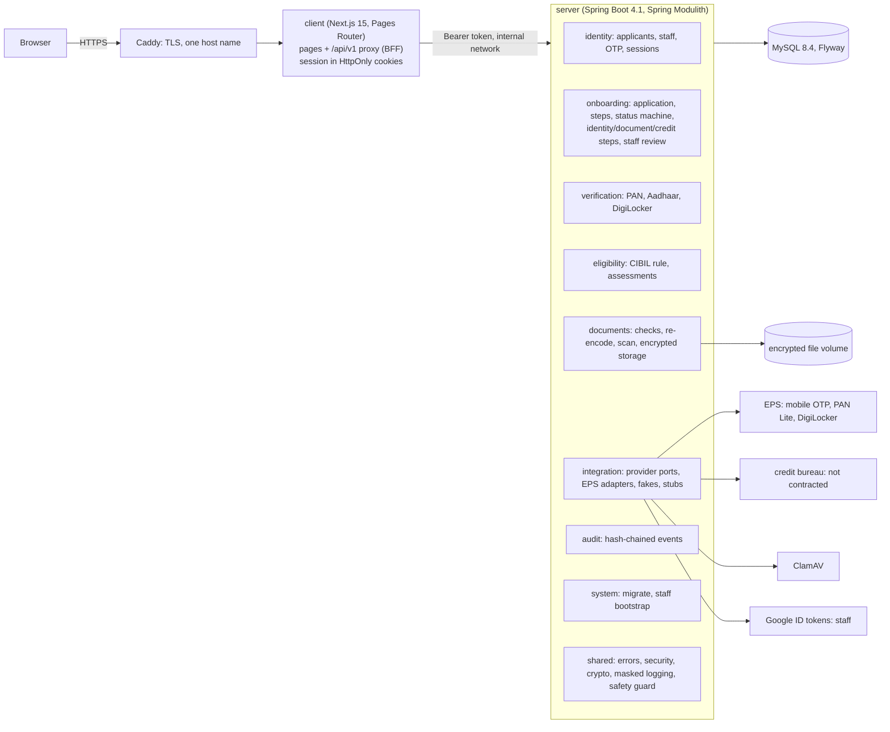

# Architecture

## Modules (server)

Each module's top-level package is its API; `internal` is private. `ModularityTests` fails the
build on a violation or a cycle. Dependencies point one way:
`onboarding → {identity, verification, eligibility, documents, audit}` and
`{verification, eligibility, documents, identity} → integration → shared`.

| Module | Owns | Public API |
|---|---|---|
| `shared` | errors (problem+json), security config, crypto, masked logging, safety guard | open module |
| `audit` | `audit_event` (hash chain) | `AuditLog`, `AuditTrail` |
| `integration` | ports and adapters, chosen by `eloka.integration.*` | `MobileOtpGateway`, `PanVerifier`, `DigiLockerProvider`, `CreditBureau`, `MalwareScanner`, `GoogleIdentityVerifier` |
| `identity` | applicants, OTP challenges, sessions, staff accounts | `StaffDirectory`, `StaffAdmin`, `IdentityProperties` |
| `documents` | stored files and their rules | `DocumentApi`, `DocumentKind` |
| `verification` | PAN and Aadhaar checks, DigiLocker sessions | `VerificationApi`, `EvidenceStatus` |
| `eligibility` | credit assessments | `EligibilityApi`, `EligibilityPolicy` |
| `onboarding` | the application, its steps and review | `PartnerStep`, `ApplicationStatus`, events |
| `system` | run-once commands | — |

## Request path

1. The browser calls `/api/v1/...` on its own origin. The proxy checks the path, the anti-forgery
   header and the Origin, adds the Bearer token from the HttpOnly cookie and forwards the call.
2. The server resolves the token to a `Caller` (applicant or staff, roles read fresh), Spring
   Security allows the route by session kind, and the controller calls a service.
3. Application writes take the application's row lock, check `If-Match`, run the step rules and
   the status machine, write the audit event and the timeline in the same transaction.
4. Provider calls go through ports; a failure never counts as a pass.

The rules the server enforces: [PARTNER_JOURNEY.md](PARTNER_JOURNEY.md). Endpoints: [API.md](API.md).
Decisions: [adr/](adr/).
