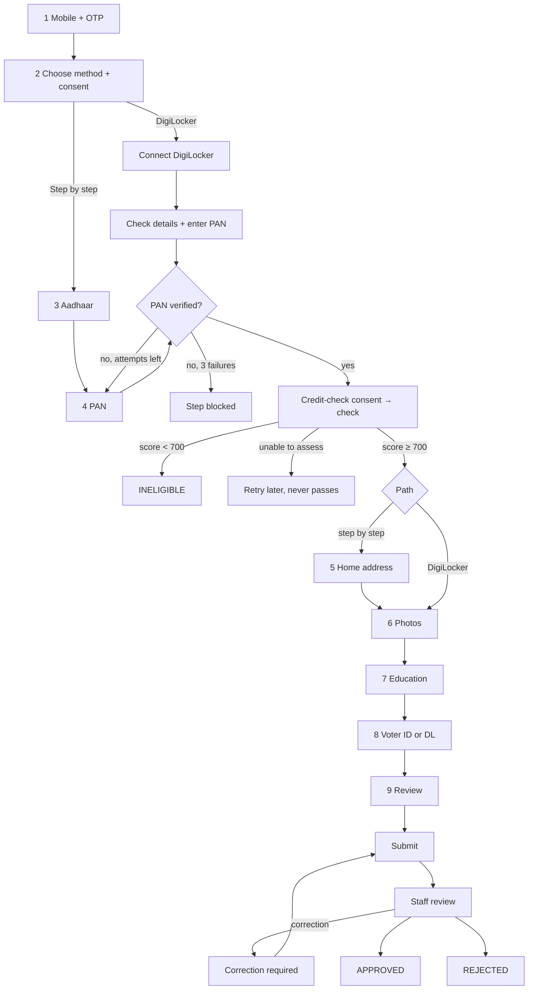

# Partner journey and state machine

The source of truth for what the applicant sees and what the server allows. The server enforces everything on this page; the client only shows it. Built step by step (see the status in [`../README.md`](../README.md)).

## Pages

| Page | Path (client) | Step key | Both paths? |
|---|---|---|---|
| 1 Mobile number + OTP | `/apply` | `MOBILE_VERIFICATION` | yes |
| 2 Choose how to apply + data-use consent | `/apply/method` | `CONSENT`, `VERIFICATION_METHOD` | yes |
| 3D Connect DigiLocker, check details, enter PAN | `/apply/digilocker` | `AADHAAR`, `HOME_ADDRESS`, `PAN` | DigiLocker |
| 3 Aadhaar (masked image + last 4 digits) | `/apply/aadhaar` | `AADHAAR` | step by step |
| 4 PAN + date of birth | `/apply/pan` | `PAN` | step by step |
| 4b Credit check (consent, result) | `/apply/credit-check` | `CREDIT_CHECK` | yes |
| 5 Home address | `/apply/address` | `HOME_ADDRESS` | step by step |
| 6 Live photo + passport-size photo | `/apply/photos` | `PHOTOS` | yes |
| 7 Graduation certificate (+ optional computer certificates) | `/apply/education` | `EDUCATION` | yes |
| 8 Voter ID or driving licence | `/apply/id-document` | `ID_DOCUMENT` | yes |
| 9 Review + declaration | `/apply/review` | `DECLARATION` | yes |
| 10 Status | `/apply/status` | — | yes |

## Application status

| Status | Meaning | Terminal |
|---|---|---|
| `IN_PROGRESS` | applicant is filling in steps | no |
| `INELIGIBLE` | verified CIBIL score below 700 | yes |
| `SUBMITTED` | waiting for a reviewer | no |
| `UNDER_REVIEW` | a reviewer has claimed it | no |
| `CORRECTION_REQUIRED` | applicant must fix listed items | no |
| `ON_HOLD` | reviewer paused it | no |
| `APPROVED` | staff approved (ends this project) | yes |
| `REJECTED` | staff rejected | yes |
| `WITHDRAWN` | applicant withdrew | yes |
| `EXPIRED` | idle too long | yes |

### Transitions (every other pair answers `409 INVALID_STATE_TRANSITION`)

| From | Event | To | Server guard |
|---|---|---|---|
| — | OTP verified, no live application | `IN_PROGRESS` | mobile has no live or approved application |
| `IN_PROGRESS`, `CORRECTION_REQUIRED` | credit result below 700 | `INELIGIBLE` | result bound to this applicant's verified PAN and consent (a PAN corrected after review runs the check again) |
| `IN_PROGRESS`, `CORRECTION_REQUIRED` | `SUBMIT` | `SUBMITTED` | all required steps satisfied, eligibility `ELIGIBLE`, current declaration, `If-Match`, `Idempotency-Key` |
| `IN_PROGRESS`, `SUBMITTED`, `CORRECTION_REQUIRED` | `WITHDRAW` | `WITHDRAWN` | a fresh OTP to the applicant's own mobile (`POST /v1/partner/reauth`); the status page offers it when `available_actions` has `WITHDRAW` |
| `IN_PROGRESS`, `CORRECTION_REQUIRED` | `EXPIRE` (job) | `EXPIRED` | idle or correction deadline passed |
| `SUBMITTED` | `CLAIM` | `UNDER_REVIEW` | reviewer role |
| `UNDER_REVIEW` | `RELEASE` | `SUBMITTED` | the claiming reviewer |
| `UNDER_REVIEW` | `REQUEST_CORRECTION` | `CORRECTION_REQUIRED` | at least one item rejected with a reason |
| `UNDER_REVIEW` | `HOLD` | `ON_HOLD` | reason |
| `ON_HOLD` | `RELEASE_HOLD` | `UNDER_REVIEW` | — |
| `UNDER_REVIEW` | `APPROVE` | `APPROVED` | every evidence item `VERIFIED`, eligibility `ELIGIBLE`, approver is not the reviewer who recommended |
| `UNDER_REVIEW`, `ON_HOLD` | `REJECT` | `REJECTED` | reason code |

Each transition runs under a row lock, writes the audit event and the applicant timeline in the same transaction, and publishes an application event.

## Steps

Step status: `NOT_STARTED`, `IN_PROGRESS`, `PENDING_EXTERNAL`, `COMPLETED`, `FAILED`, `BLOCKED`, `LOCKED`, `REOPENED`, `NOT_APPLICABLE`.

| Step | Needs first | Done when |
|---|---|---|
| `MOBILE_VERIFICATION` | — | OTP verified |
| `CONSENT` | mobile | current data-use consent recorded |
| `VERIFICATION_METHOD` | consent | `DIGILOCKER` or `MANUAL` chosen |
| `AADHAAR` | method | DigiLocker result verified, or masked images + last 4 digits submitted |
| `PAN` | Aadhaar | provider says the PAN is valid and the name matches the Aadhaar name |
| `CREDIT_CHECK` | PAN | outcome `ELIGIBLE` |
| `HOME_ADDRESS` | credit check | address saved (self-declared) or DigiLocker address confirmed |
| `PHOTOS` | credit check, home address | live photo and passport-size photo submitted |
| `EDUCATION` | credit check, home address | graduation certificate submitted |
| `ID_DOCUMENT` | credit check, home address | voter ID or driving licence (or both) submitted |
| `DECLARATION` | all of the above | current declaration accepted |

Re-doing a step resets later steps that depend on it: a new PAN resets `CREDIT_CHECK` and `DECLARATION`; a new method resets `AADHAAR` and `HOME_ADDRESS`; any document change resets `DECLARATION`.

## Evidence status (per document or check)

`NOT_STARTED`, `PENDING`, `SUBMITTED`, `VERIFICATION_IN_PROGRESS`, `VERIFIED`, `REJECTED`, `VERIFICATION_FAILED`, `MANUAL_REVIEW_REQUIRED`.

- To move on, an item must be `VERIFIED`, or `SUBMITTED` / `MANUAL_REVIEW_REQUIRED` when only a person can check it (masked Aadhaar, photos, certificates, ID images).
- **Approval needs every item `VERIFIED`.** Submitting something never makes it verified.

## Eligibility

See ADR-0005. `ELIGIBLE` only for a verified score of 700 or more. `UNABLE_TO_ASSESS` is retried at most 3 times, then the step is `BLOCKED` until staff act. It never counts as eligible.
