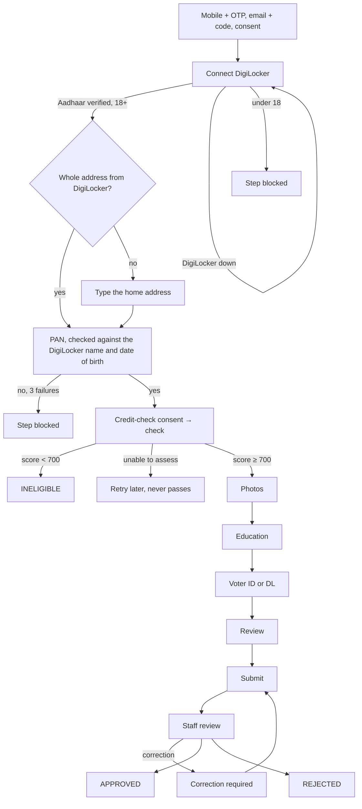

# Partner journey and state machine

The source of truth for what the applicant sees and what the server allows. The server enforces everything on this page; the client only shows it. Built step by step (see the status in [`../README.md`](../README.md)).

## Pages

One page can hold several steps (ADR-0007). Identity is DigiLocker only; the step-by-step path is retired.

| Page | Path (client) | Step keys |
|---|---|---|
| Contact details: mobile number + OTP, then email + code and the data-use consent (one card) | `/apply` | `MOBILE_VERIFICATION`, `EMAIL_VERIFICATION`, `CONSENT` |
| Identity and eligibility, as tasks: Aadhaar through DigiLocker, home address (typed only if DigiLocker's is incomplete), PAN, credit check, then a voter ID or driving licence checked with its government record | `/apply/identity` (`#aadhaar`, `#address`, `#pan`, `#eligibility`, `#alternate-id`) | `AADHAAR`, `HOME_ADDRESS`, `PAN`, `CREDIT_CHECK`, `ALTERNATE_ID` |
| Live photo + passport-size photo | `/apply/photos` | `PHOTOS` |
| Documents, in two groups: identity (Aadhaar front and back as full images, PAN card, both sides of the verified voter ID or driving licence) and education (class 10 and 12 marksheets, graduation certificate, an optional diploma certificate, up to 5 optional computer certificates) | `/apply/documents` (`#identity-documents`, `#education`) | `KYC_DOCUMENTS`, `EDUCATION` |
| Review + declaration | `/apply/review` | `DECLARATION` |
| Status | `/apply/status` | — |

Old addresses (`/apply/method`, `/aadhaar`, `/pan`, `/address`, `/digilocker`, `/credit-check`) redirect to
`/apply/identity`, keeping `?state=` for a DigiLocker return. Progress shows six parts (contact, identity,
eligibility, photos, documents, review) from the server's step statuses, not a count of screens.

**DigiLocker trips.** "Continue to DigiLocker" (or "Start again") ends any earlier unfinished trip; at most
10 trips per hour. Back with `?state=`, the page finishes the trip once and, while DigiLocker is still working,
checks again by itself for about a minute and a half. A trip finished in another browser (or the DigiLocker
app opening a different one) asks for the mobile code there and then finishes. Redoing DigiLocker on a done
step keeps it done until DigiLocker answers; the same identity again changes nothing after it.

## Application status

| Status | Meaning | Terminal |
|---|---|---|
| `IN_PROGRESS` | applicant is filling in steps | no |
| `INELIGIBLE` | verified CIBIL score below 700 | yes |
| `SUBMITTED` | waiting for a reviewer | no |
| `UNDER_REVIEW` | a reviewer has claimed it | no |
| `CORRECTION_REQUIRED` | applicant must fix listed items | no |
| `ON_HOLD` | reviewer paused it | no |
| `APPROVED` | staff approved (ends this project) | yes |
| `REJECTED` | staff rejected | yes |
| `WITHDRAWN` | applicant withdrew | yes |
| `EXPIRED` | idle too long | yes |

### Transitions (every other pair answers `409 INVALID_STATE_TRANSITION`)

| From | Event | To | Server guard |
|---|---|---|---|
| — | OTP verified, no live application | `IN_PROGRESS` | mobile has no live or approved application |
| `IN_PROGRESS`, `CORRECTION_REQUIRED` | credit result below 700 | `INELIGIBLE` | result bound to this applicant's verified PAN and consent (a PAN corrected after review runs the check again) |
| `IN_PROGRESS`, `CORRECTION_REQUIRED` | `SUBMIT` | `SUBMITTED` | all required steps satisfied, eligibility `ELIGIBLE`, current declaration, `If-Match`, `Idempotency-Key` |
| `IN_PROGRESS`, `SUBMITTED`, `CORRECTION_REQUIRED` | `WITHDRAW` | `WITHDRAWN` | a fresh OTP to the applicant's own mobile (`POST /v1/partner/reauth`); the status page offers it when `available_actions` has `WITHDRAW` |
| `IN_PROGRESS`, `CORRECTION_REQUIRED` | `EXPIRE` (job) | `EXPIRED` | idle or correction deadline passed |
| `SUBMITTED` | `CLAIM` | `UNDER_REVIEW` | reviewer role |
| `UNDER_REVIEW` | `RELEASE` | `SUBMITTED` | the claiming reviewer |
| `UNDER_REVIEW` | `REQUEST_CORRECTION` | `CORRECTION_REQUIRED` | at least one item rejected with a reason |
| `UNDER_REVIEW` | `HOLD` | `ON_HOLD` | reason |
| `ON_HOLD` | `RELEASE_HOLD` | `UNDER_REVIEW` | — |
| `UNDER_REVIEW` | `APPROVE` | `APPROVED` | every evidence item `VERIFIED`, eligibility `ELIGIBLE`, approver is not the reviewer who recommended |
| `UNDER_REVIEW`, `ON_HOLD` | `REJECT` | `REJECTED` | reason code |

Each transition runs under a row lock, writes the audit event and the applicant timeline in the same transaction, and publishes an application event.

**Closing never deletes.** Withdrawing (and every other terminal status) changes the status only: steps, files,
checks, consents, the address, the credit result, the photo location and the audit trail stay (a test counts them
before and after). An unfinished DigiLocker trip is ended (`ClosedApplications`). The default staff queue leaves
closed applications out; staff can still look them up by status, but no review action applies. Withdrawing while
staff are reviewing (`UNDER_REVIEW`, `ON_HOLD`) is not allowed (docs/OPEN_QUESTIONS.md Q-33), and when anything
is deleted is Q-5.

## Steps

Step status: `NOT_STARTED`, `IN_PROGRESS`, `PENDING_EXTERNAL`, `COMPLETED`, `FAILED`, `BLOCKED`, `LOCKED`, `REOPENED`, `NOT_APPLICABLE`.

| Step | Needs first | Done when |
|---|---|---|
| `MOBILE_VERIFICATION` | — | OTP verified |
| `EMAIL_VERIFICATION` | mobile | a code sent to the address was entered (one open, approved or ineligible application per address) |
| `CONSENT` | email | current data-use consent recorded |
| `AADHAAR` | consent | DigiLocker result verified and the person is 18 or older |
| `HOME_ADDRESS` | Aadhaar | the DigiLocker address, or (only when DigiLocker's is incomplete, or a reviewer reopened it) one typed by the applicant |
| `PAN` | Aadhaar | provider says the PAN is valid and matches the DigiLocker name and date of birth |
| `CREDIT_CHECK` | PAN | outcome `ELIGIBLE` |
| `ALTERNATE_ID` | credit check | a voter ID or driving licence found in its government record (EPS), a licence active, the date of birth (where the record has one) the DigiLocker one, and the holder's name a match for the DigiLocker name (EPS Name Match ≥ `eloka.verification.name-match-min-score`, 0.85); one document per open application. 3 tries per document type. When both are used up the step blocks, and the applicant can take the step-by-step way: send one number for our team to check by hand (`POST …/alternate-id-reviews`); the step is then done for the applicant, its evidence waits as `MANUAL_REVIEW_REQUIRED`, the images of that document are still required, and approval needs a reviewer to mark it verified (C-10). An outage uses nothing |
| `PHOTOS` | credit check, home address, alternate ID | live photo (taken with the camera, with the browser's location: required, never invented, at most 1000 m rough, taken within 5 min; rougher than 100 m or outside India is flagged for staff) and passport-size photo submitted |
| `KYC_DOCUMENTS` | photos | Aadhaar front and back (full images, ADR-0008), PAN card, and both sides of a voter ID or driving licence verified in `ALTERNATE_ID` submitted |
| `EDUCATION` | photos | class 10 and class 12 marksheets and the graduation certificate submitted (a diploma certificate optional; computer certificates optional, up to 5). Before 2026-10-29 a diploma could stand in for graduation; an application completed that way is asked for the graduation certificate at submit |
| `DECLARATION` | all of the above | current declaration accepted |

Re-doing a step **with different data** resets later steps that depend on it (each step keeps a blind-index fingerprint of the data it was completed with, so redoing it with the same PAN, DigiLocker identity or address changes nothing after it): a new DigiLocker identity resets `PAN`, `ALTERNATE_ID`, `KYC_DOCUMENTS` and what follows them; a new PAN resets `CREDIT_CHECK`, `KYC_DOCUMENTS` and `DECLARATION`; another verified ID document resets `KYC_DOCUMENTS` (its images must match) and `DECLARATION`; any document change resets `DECLARATION`. Whenever `KYC_DOCUMENTS` is reset or reopened, its images go back to "review needed" for staff. The same file in two places is refused (`DUPLICATE_FILE`).

## Evidence status (per document or check)

`NOT_STARTED`, `PENDING`, `SUBMITTED`, `VERIFICATION_IN_PROGRESS`, `VERIFIED`, `REJECTED`, `VERIFICATION_FAILED`, `MANUAL_REVIEW_REQUIRED`.

- To move on, an item must be `VERIFIED`, or `SUBMITTED` / `MANUAL_REVIEW_REQUIRED` when only a person can check it (Aadhaar, PAN and ID images, photos, certificates).
- **Approval needs every item `VERIFIED`.** Submitting something never makes it verified.

## Eligibility

See ADR-0005. `ELIGIBLE` only for a verified score of 700 or more. `UNABLE_TO_ASSESS` is retried at most 3 times, then the step is `BLOCKED` until staff act. It never counts as eligible.

## Blocked steps

A step that used up its tries (PAN, DigiLocker, credit check, voter ID / driving licence, under 18) is `BLOCKED`.
Staff find these applications in the queue under "Blocked", speak to the applicant, and unblock the step with a
reason (`POST …/steps/{step}/unblock`): its tries start again. Unblocking the credit check is a new bureau
enquiry, so only an approver can. An under-18 block should not be unblocked until the person is 18.

## Review page

Before submitting, the applicant sees what still stops submission (the snapshot's `submit_blockers`), each with
a link to the part to fix; links and "Change" carry `?return=review` and the part's anchor, and those pages offer
"Back to review". Each done part says where it came from (verified through DigiLocker or with the government
record, checked with the credit bureau, added by the applicant, or uploaded for our team to check). Verified
results (Aadhaar, PAN, credit check, voter ID or driving licence) and a DigiLocker address have no "Change": they
are read-only in the client; when staff reopen one in a correction, its form opens by itself. The server still
accepts a redone check on these steps (docs/OPEN_QUESTIONS.md Q-30 decides whether it should stop).
Submitting asks for confirmation once, then sends one request. The review and status pages show the
verified mobile and email masked (`snapshot.contact`). No email or SMS is sent when the status changes (no
notification service exists yet), so the pages say "check this page for updates" and never promise a message.
